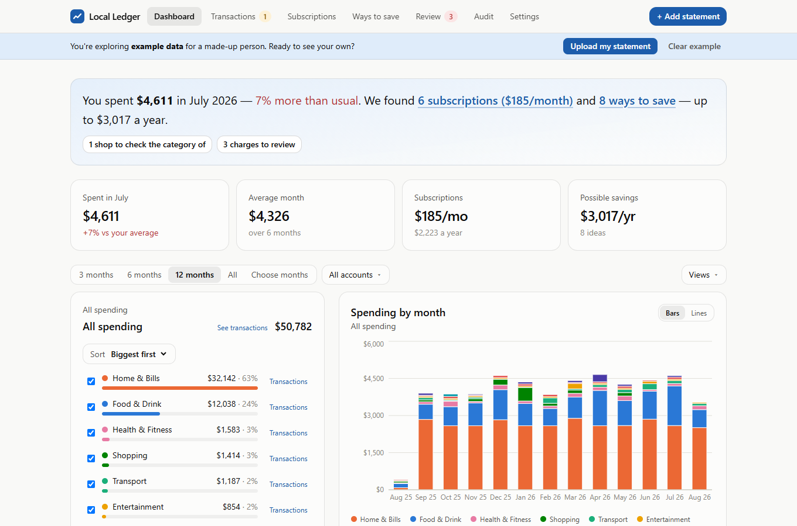
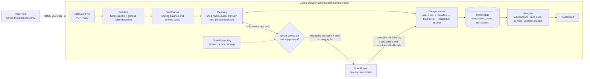
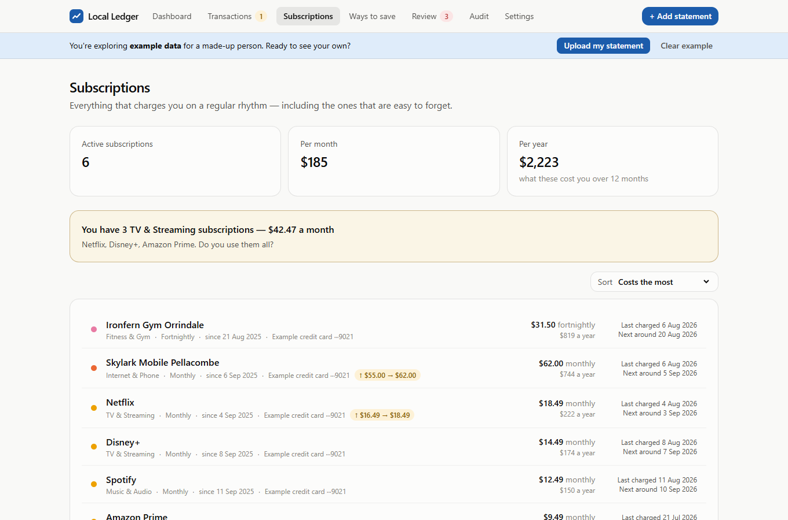
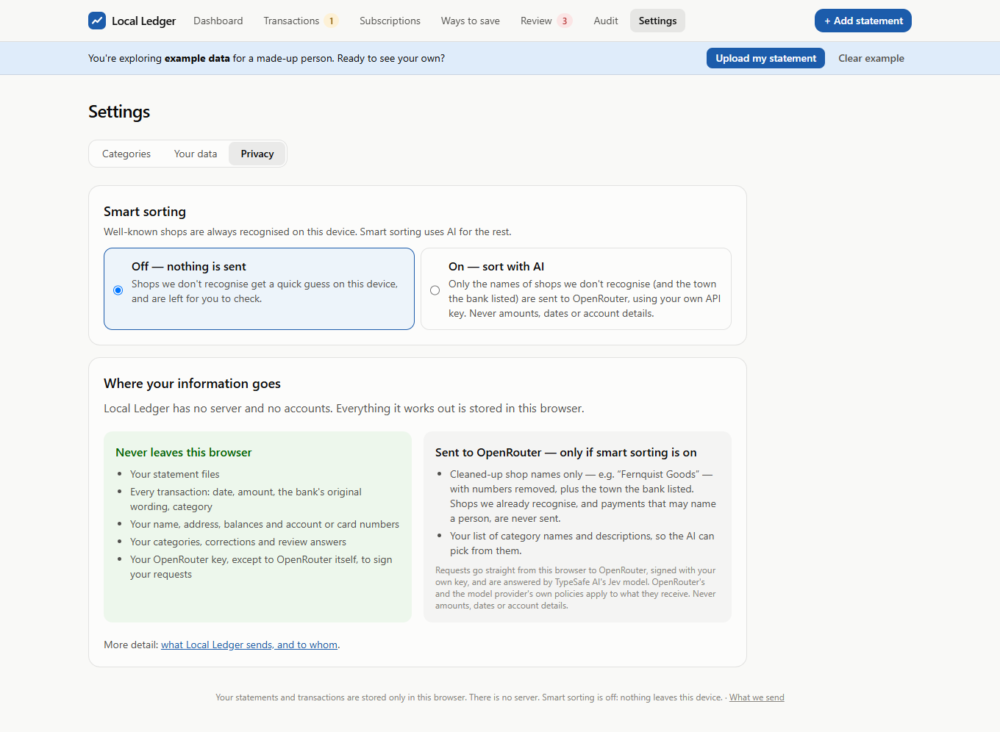

# Local Ledger

Local Ledger turns Australian bank statements (PDF or CSV) into a spending dashboard. It shows subscriptions, savings ideas and charges worth a second look. It runs entirely in the browser: statements are parsed, categorised and stored on the user's device, and an LLM is consulted only if the user opts in, using their own API key and seeing nothing but cleaned shop names.

**[Try it live →](https://marknuttall101.github.io/local-ledger/)**. It needs no sign-up and no key, and nothing you load leaves your browser.

### Quick start (2 minutes, made-up data)

1. Download the two example statements: right-click each link and choose **Save link as** (a plain click just shows the file as text): [everyday account](https://github.com/Marknuttall101/local-ledger/raw/main/examples/sample-everyday-account.csv) and [credit card](https://github.com/Marknuttall101/local-ledger/raw/main/examples/sample-credit-card.csv). They cover a year of an invented person's banking.
2. Open the [live demo](https://marknuttall101.github.io/local-ledger/) and drag both files onto the page.
3. Check each preview and click **Looks right**. For the credit card file, make sure **Which account is this?** says **A new account**. You'll then see the dashboard, subscriptions, savings ideas and flagged charges.

Without an OpenRouter key, shops the app doesn't already know get a rough on-device guess, so your import will be rougher than the built-in example. To skip the download, click **Try it with example data** instead: its categories are pre-filled from a saved smart-sorting run, and nothing is sent. **Settings → Your data → Delete all my data** clears everything afterwards.

To see the privacy design at work, open **What we send** (top right) for exactly what leaves the browser, and the **Audit** tab for how every transaction was sorted.



## The problem

The most useful view of personal spending needs line-level transaction data, and that is among the most sensitive data a person has. Statement lines carry account and card numbers, balances, employers, the names of people paid and where someone lives and shops. The usual answers each give something up:

- **Bank-feed aggregators** need standing access to the account through a third party.
- **Upload-to-server tools** create a central store of everyone's statements.
- **LLM-first tools** send raw statement text to a model provider.

Local Ledger asks how much of that analysis can happen with **no server-side data at all**, and how little an LLM needs to see to still be useful.

## Architecture



There is no application server. The site is static files, so any static host (or `npm run preview`) serves it, and the host never receives user data.

| Layer | Where | Notes |
|---|---|---|
| Statement readers | [`src/core/readers/`](src/core/readers) | A layout-aware Westpac PDF reader, CSV presets for CommBank, Westpac, ANZ and NAB, and a generic reader that rebuilds a table from any PDF's text positions and guesses the columns. |
| Verification | [`src/core/readers/verify.ts`](src/core/readers/verify.ts) | Every row must explain the change in running balance, or the totals must match the statement's printed totals. Otherwise the user is asked to confirm the column mapping. |
| Cleaning | [`src/core/clean.ts`](src/core/clean.ts) | Turns `PAYPAL *COLESSUPERM 5550001234 AUS` into `Coles`. Strips card codes, reference numbers, company suffixes and payment-app wording, and detects descriptions that may contain a person's name. |
| Categorisation | [`src/core/categorise.ts`](src/core/categorise.ts) | Cheapest and most private first: the user's own rules, then transfer detection, then a built-in list of about 100 Australian merchants, then a cached AI answer. |
| AI client | [`src/services/openrouter.ts`](src/services/openrouter.ts) | The only code that talks to another site. |
| Storage | [`src/db/db.ts`](src/db/db.ts) | IndexedDB via Dexie. Backups are a JSON export of this database. |
| Analysis | [`src/core/subscriptions.ts`](src/core/subscriptions.ts), [`savings.ts`](src/core/savings.ts), [`fraud.ts`](src/core/fraud.ts) | Recurring charges from weekly to yearly, price rises, overlapping services, spending creep, duplicate and card-testing charges. |

Stack: TypeScript, React 19, Vite, Tailwind, Dexie (IndexedDB), pdf.js, Recharts, Vitest.

## Privacy design

There are two modes, and the user chooses. Local mode is the default.

| | Local mode (default) | Smart sorting (opt-in) |
|---|---|---|
| Statement files, amounts, dates, balances, account numbers, original bank wording | Browser only | Browser only |
| Unknown shops | Keyword guess on the device, flagged for the user to check | Cleaned name, plus the town the bank printed, sent to OpenRouter |
| Network requests made by the app | None | `openrouter.ai` only |
| Needs an API key | No | The user's own OpenRouter key |

**What reaches the LLM, and what doesn't.** For each shop the app can't already place, the request carries:
- the cleaned shop name, for example `Quillhaven Trading`;
- the town the bank printed after it, if any, for example `NSW`;
- the user's category names and descriptions.

Each shop is asked about once, and the answer is cached. The following are filtered out on the device before anything is built:
- shops the built-in list recognises;
- transfers;
- refunds and income;
- any description that may name a person (Osko, PayID, Beem, pay-anyone and similar wording).

[`isSafeToSend`](src/services/openrouter.ts) is a last check before any request: it refuses text with a run of four or more digits, text over 60 characters, and a "town" that isn't purely letters. Tests in [`services.test.ts`](src/services/services.test.ts) assert that a request body never contains the amount, date, account suffix, file name or original wording.

**How the API key is handled.**
- It is entered in the app and checked against OpenRouter's `GET /api/v1/key`. The app shows the key's label and spending limit, and warns if there is no limit.
- It is kept in `sessionStorage` by default, so it is forgotten when the tab closes. It goes in `localStorage` only if the user ticks "Remember on this device".
- It is deliberately kept out of IndexedDB. The backup feature exports that database, and a test checks that the key never appears in a backup.
- It is sent only to `openrouter.ai`, in the `Authorization` header, with `credentials: 'omit'` and no referrer.
- There is no environment variable for it on purpose. Vite copies `VITE_*` variables into the public bundle.
- See [`src/services/apiKey.ts`](src/services/apiKey.ts).

**Where data lives between visits, and how to clear it.**

| What | Where | Lasts | Cleared by |
|---|---|---|---|
| Transactions, accounts, categories, rules, corrections, review answers | The browser's IndexedDB, database `local-ledger` | Until cleared. It survives reloads and restarts, on this browser profile and device only. | Settings → Your data → **Delete all my data**, or clearing this site's data in the browser |
| OpenRouter key (default) | `sessionStorage` | Until the tab is closed | Closing the tab, Settings → Privacy → **Forget key**, or **Delete all my data** |
| OpenRouter key ("Remember on this device") | `localStorage` | Until cleared | Settings → Privacy → **Forget key**, **Delete all my data**, or clearing site data |
| Page preferences (filters, search, sort order, open tab) | `localStorage` (`local-ledger.*`) | Until cleared | **Delete all my data**, or clearing site data |

- Data never moves between devices or browsers on its own. To move it, use Settings → Your data → **Download backup** and **Restore a backup**. The backup file holds everything except the key.
- The app asks the browser for persistent storage, so the data isn't evicted under storage pressure. Browsers can still remove it: Safari deletes a site's data after seven days without a visit, and private windows discard it on close. The app warns when persistence isn't granted.
- Browser storage belongs to an origin (scheme + host), not a path. If you host your own copy, give it an origin of its own, such as a subdomain, rather than a path on a domain that serves other apps. Every GitHub Pages project site under one account shares an origin; this account has no others.

**Backed by the browser, not just by convention.** The production build carries a Content-Security-Policy with `connect-src 'self' https://openrouter.ai`, scripts, images and fonts limited to the site itself, and `form-action 'none'`. The browser blocks the page's own network requests (fetch, XHR, WebSockets, beacons), image and script loads, and form posts to any other origin, so a bug or a compromised dependency can't quietly send data elsewhere through those routes. It is a strong safety net, not a complete guarantee: the policy arrives in a `<meta>` tag, because GitHub Pages can't send headers, and a page policy doesn't stop the page from navigating to or opening another site, doesn't cover browser extensions, and can't block framing (the app checks for that itself and won't run inside another site's frame). CI checks that the policy is in the built page. The end-to-end script ([`scripts/screenshots.mjs`](scripts/screenshots.mjs)) fails on any CSP violation or any request to another origin.

### Trade-offs

- **No server-side storage at all.** An earlier version synced a cleaned, AES-256-GCM-encrypted copy of each user's history to Postgres, so it could follow them across devices. The server held the key, which made that encryption at rest, not end-to-end. This public version removes the server, the accounts and the sync. The cost: data lives on one device, and the browser can evict it (Safari does after seven days without a visit). The app asks for persistent storage and offers a one-file backup and restore.
- **No web enrichment.** The hosted version also looked up unknown shops through a search API before asking the model. That needed a second third-party key and sent shop names to a second company, so it was dropped. Accuracy on obscure local businesses is lower as a result. Corrections are remembered per shop, so each one is fixed once.
- **The town goes to the model.** It is the one piece of location data sent, because it is often the only thing that tells two businesses with the same name apart. It comes from the merchant's descriptor, not the user's address.
- **BYOK, not a shared key.** A shared key would need a server to hide it and rate-limit it, which brings back everything above. Each user pays for their own usage. At about one request per new shop, that is cents per statement.

### Design roadmap

The planned path back to multi-device use, without a server that can read data:
1. Encrypt a rolling 12-month package in the browser (AES-GCM, with the key derived from a passkey PRF where available, or PBKDF2-SHA256 with 600,000 iterations from a passphrase).
2. Issue a recovery code at setup.
3. Let the server store only ciphertext and a version number, so stale writes are refused.

This is a design, not a feature of this repository.

## How the LLM classification works

The model is Jev from TypeSafe AI, called through OpenRouter's Decisions API. Jev answers structured questions with calibrated probabilities instead of free text, which suits classification:

```jsonc
{
  "model": "typesafe/jev-1.13",
  "state": "A merchant name as it appears on an Australian bank or credit card statement: \"Quillhaven Trading\" (the bank listed the town as \"NSW\")",
  "questions": {
    "category":     { "type": "choice", "criteria": { "<categoryId>": "<name>: <description>", "…": "…" } },
    "subscription": { "type": "noul", "instructions": "Is this merchant a recurring subscription service…?" },
    "suspicious":   { "type": "noul", "instructions": "Does this merchant name look like a scam or card-testing charge?" }
  }
}
```

- **The user's categories are the label set.** Renaming a category or editing its description changes what the model chooses between, with no retraining.
- **Confidence drives the UI.** Answers at or above `0.6` are accepted. Anything lower, or anything the on-device guesser decided, appears under "Needs a quick look". The Audit tab shows every AI decision, its confidence, and how often the user overrode it, and exports it as CSV.
- **Corrections become rules.** Recategorising a shop asks "just this one, or the whole shop?". The whole-shop answer is stored as a rule that outranks the model from then on, and every correction is logged.
- **Failure is graceful.** A refused key, exhausted credit or no connection stops further requests in that run, and every shop keeps its on-device guess.
- **Subscription and fraud signals** from the model are combined with on-device evidence: a regular rhythm for subscriptions, and duplicate, first-time-overseas or tiny first charges for fraud. They're never used alone.

## Key design decisions

- **Deterministic before probabilistic.** Parsing, verification, transfer matching, deduplication, recurrence detection and savings rules are plain, tested code. The LLM is used for the one task with no deterministic answer: what a never-seen business sells.
- **The bank's own numbers are the test oracle.** A statement is accepted without questions only when the parsed rows reconcile to the running balance or the printed totals.
- **Minimise at the source, not the boundary.** Text bound for the model is built from already-cleaned fields, filtered for personal names on the device, then checked again just before sending.
- **Hash routes and relative paths,** so the build runs from any static host or folder with no server configuration.
- **Made-up data everywhere.** The example year in [`src/core/sampleData.ts`](src/core/sampleData.ts) is generated deterministically, is the source of the CSVs in [`examples/`](examples), and is covered by a test that fails if they drift. No real statement has ever been committed to this repository.

## Run it locally

Requires Node 20 or later.

```bash
npm ci
npm run dev          # http://localhost:5173
```

To try it, click **Try it with example data**, or drag in [`examples/sample-everyday-account.csv`](examples/sample-everyday-account.csv) and [`examples/sample-credit-card.csv`](examples/sample-credit-card.csv). Smart sorting is optional. To test it, add an OpenRouter key with a low spending limit under Settings → Privacy.

```bash
npm test             # unit and integration tests (Vitest, IndexedDB faked in Node)
npm run typecheck
npm run build        # static site in dist/, with the Content-Security-Policy
npm run preview      # serve the production build
npm run screenshots  # end-to-end run in headless Chrome against the build; regenerates docs/screenshots
```

Known limitation: the main bundle is about 900 kB (280 kB gzipped), mostly the charting library. pdf.js is split out and only loaded when a PDF is opened.

## Status

Parked as a product; maintained as a reference implementation. Bug reports are welcome (see [CONTRIBUTING.md](CONTRIBUTING.md)), and security or privacy issues should be reported as described in [SECURITY.md](SECURITY.md).

| | |
|---|---|
|  |  |

## Author

Built by Mark Nuttall, Nuttall Quant Solutions Pty Ltd - AI and data science consulting, Sydney.

Released under the [MIT License](LICENSE).
